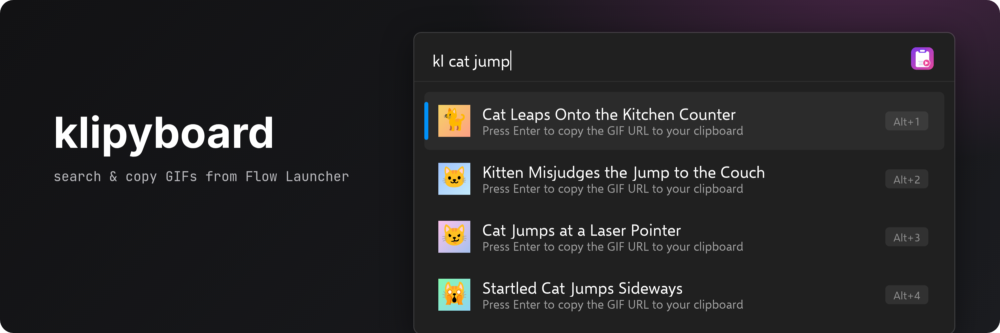

<!-- generated by readwright from docs/README.md.j2; edit the template, not this file -->


# klipyboard

Search and copy Klipy GIF URLs from Flow Launcher

[](https://github.com/Garulf/klipyboard/actions/workflows/ci.yml) [](https://github.com/Garulf/klipyboard/releases/latest) [](https://github.com/Garulf/klipyboard/blob/main/LICENSE)

[](https://www.buymeacoffee.com/garulf) [](https://github.com/sponsors/Garulf)

## Features

* **Search Klipy's GIFs.** `kl cat jump` finds GIFs as you type.
* **Trending at a glance.** Type `kl` on its own to browse what's trending.
* **One key to copy.** `Enter` puts the GIF's URL on your clipboard, ready to paste into a chat.
* **Thumbnails.** Every result shows the GIF's thumbnail, cached on disk after the first search.

## Usage

Type `kl` followed by a search term, then press `Enter` to copy the GIF's URL:

```
kl cat jump
```


Type `kl` alone to browse trending GIFs:


## Configuration

Klipyboard needs a Klipy API key. Get one from [Klipy's developer page](https://klipy.com/developers), then
open **Settings → Plugins → Klipyboard** in Flow Launcher and paste it into **Klipy API key**. Until a key
is set, `kl` offers to open the settings for you:


## Installation

Klipyboard isn't in the Flow Launcher plugin store yet. Download `klipyboard-<version>.zip` from the
[latest release](https://github.com/Garulf/klipyboard/releases/latest) and unzip it into `%appdata%\FlowLauncher\Plugins\Klipyboard`,
then restart Flow Launcher.

Pre-releases of the next version are published from the open release PR on the
[releases page](https://github.com/Garulf/klipyboard/releases) for testing. Flow Launcher won't offer them as updates.

## Requirements

* Flow Launcher 1.17.0 or newer
* Python 3.9 or newer, which Flow Launcher can install for you

## Development

```bash
uv sync
uv run pytest
uv run tox                # flake8, mypy and the tests on Python 3.9 and 3.14
scripts/package.sh        # builds dist/klipyboard-<version>.zip
```

Screenshots are rendered with [flow-render](https://github.com/Garulf/flow-render):

```bash
uv run --no-project --with flow-render==0.15.0 python docs/screenshots/render.py
```

## Changelog

### [0.3.3](https://github.com/Garulf/klipyboard/compare/v0.3.2...v0.3.3) (2026-11-17)

#### Bug Fixes

* update pyflowlauncher to 1.2.2 ([4a2275c](https://github.com/Garulf/klipyboard/commit/4a2275c0b564e2e58a8af90f05f94a115756cc72))
* update pyflowlauncher to 1.2.2 and refresh release tooling ([8437678](https://github.com/Garulf/klipyboard/commit/84376780dba28782cc1744a1f2dfa6f496a73775))

### [0.3.2](https://github.com/Garulf/klipyboard/compare/v0.3.1...v0.3.2) (2026-09-04)

#### Bug Fixes

* rely on pyflowlauncher's MRO-based exception dispatch ([bd1699c](https://github.com/Garulf/klipyboard/commit/bd1699ca80e119e9c316df9f7d529745871d67bf))

### [0.3.1](https://github.com/Garulf/klipyboard/compare/v0.3.0...v0.3.1) (2026-09-03)

#### Bug Fixes

* correct pyproject.toml/plugin.json version and release-please markers ([fae7cbd](https://github.com/Garulf/klipyboard/commit/fae7cbd42219764c0f931eb63564e089b6226f49))

See [CHANGELOG.md](CHANGELOG.md) for the full history.

## Contributing

Issues and pull requests are welcome at [Garulf/klipyboard](https://github.com/Garulf/klipyboard).

## License

MIT
